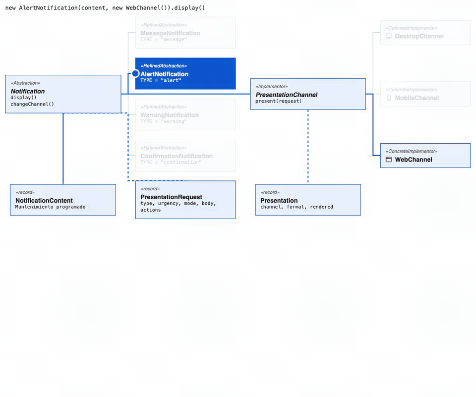

# Actividad de patrones de diseño — punto 2

Java 21. Patrón estructural **Bridge** para avisos que se muestran en escritorio, celular y web.

## Por qué Bridge

Hay dos cosas que cambian por su cuenta: el tipo de aviso (mensaje, alerta, advertencia o confirmación) y el lugar donde se muestra (escritorio, celular o web). Si cada combinación fuera una clase, harían falta doce, y cada tipo o plataforma nueva obligaría a crear varias más.

Bridge separa esas dos partes. La notificación decide qué decir y qué tan urgente es. El canal solo lo dibuja en su plataforma. Así se agrega un tipo o un canal sin tocar el otro, y un mismo aviso puede pasar de la web al celular sin crear otra clase.

| Ejercicio | Cómo lo hace el código |
| --- | --- |
| Separar el aviso del medio | `Notification` define el significado. `PresentationChannel` solo lo dibuja. |
| Agregar una plataforma o un tipo sin tocar el resto | Un tipo nuevo extiende `Notification`. Un canal nuevo extiende `PresentationChannel`. Ninguno importa las clases concretas del otro lado. |
| Menos clases | 4 tipos + 3 canales = 7 clases, no 12. |
| Cambiar la plataforma en tiempo de ejecución | `changeChannel` reemplaza el canal. El contenido sigue igual. |


## Roles

| Rol del patrón | Clase |
| --- | --- |
| Abstracción | `Notification` |
| Abstracción refinada | `MessageNotification`, `AlertNotification`, `WarningNotification`, `ConfirmationNotification` |
| Implementador | `PresentationChannel` |
| Implementador concreto | `DesktopChannel`, `MobileChannel`, `WebChannel` |
| Contrato del puente | `PresentationRequest` |

El tipo elige la urgencia, el modo y las acciones. El canal convierte ese contrato en su propio formato. El mismo modo bloqueante es un diálogo en el escritorio, una hoja de acciones en el celular y un modal en la web. El celular además corta el texto a 80 caracteres. Escritorio y web lo dejan completo.

## Diagrama de clases

`Notification` es la abstracción. `PresentationChannel` es el implementador. La agregación entre las dos es el puente: un aviso guarda un canal, y `changeChannel` lo reemplaza en tiempo de ejecución. `PresentationRequest` es el único contrato que cruza ese enlace.


Fuente: [`docs/class-diagram.dot`](docs/class-diagram.dot). Hay una copia PNG en [`docs/class-diagram.png`](docs/class-diagram.png). Abre [`docs/behavior.html`](docs/behavior.html) para ver cómo un tipo cruza el puente.



`AlertNotification` en `WebChannel`. El punto sigue `display()`: la alerta prepara la petición, el canal la dibuja y el banner se queda visible.

## Estructura

```
src/main/java/co/edu/unisabana/patterns/notification
├── NotificationApplication.java
├── abstraction/Notification.java
├── type/
├── channel/
└── model/
```

`model` guarda los registros y los enums del contrato. No es un segundo patrón.

## Cómo ejecutarlo

Hace falta JDK 21. En esta máquina:

```bash
export JAVA_HOME=/opt/homebrew/opt/openjdk@21
./mvnw test
./mvnw -q compile exec:java
```
