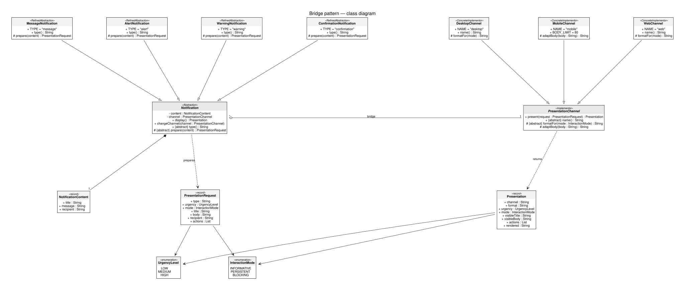

# Design patterns activity — exercise 2

Java 21. Structural **Bridge** for notifications rendered on desktop, mobile, and web.

## How the guide maps to patterns

| Exercise | Problem | Category | Pattern |
| --- | --- | --- | --- |
| 1 | Telescoping constructor for a car | Creational | Builder (already done) |
| 2 | One subclass for every type and platform | **Structural** | **Bridge** |
| 3 | Every chat user knows every other user | Behavioral | Mediator |

This repository implements exercise 2. Builder already fills the creational slot, so Bridge fills the structural one.

## Why Bridge

The scenario asks for four notification types (message, alert, warning, confirmation) on three platforms. Inheritance produces one class per pair:

`4 types × 3 platforms = 12 subclasses`, and every new platform or type multiplies the rest.

The benefits required by the guide match the Bridge intent (GoF): decouple an abstraction from its implementation so the two can vary independently.

| Required benefit | How the code does it |
| --- | --- |
| Separate the notification from the medium | `Notification` defines the meaning. `PresentationChannel` only renders. |
| Add a platform or a type without touching the rest | A new type extends `Notification`. A new channel extends `PresentationChannel`. Neither imports the concrete classes on the other side. |
| Fewer classes | 4 types + 3 channels = 7 classes, not 12. |
| Change the platform at runtime | `changeChannel` replaces the implementor. The content stays the same. |

Other candidates:

- **Strategy** (behavioral) varies only the rendering algorithm. Here the type also has its own behavior: urgency, interaction mode, and actions.
- **Adapter** (structural) wraps an existing incompatible interface. There is none.
- **Abstract Factory** (creational) would build a family per platform and would not let an existing notification change channel. Exercise 1 already used the creational slot.

## Roles

| GoF role | Class |
| --- | --- |
| Abstraction | `Notification` |
| Refined Abstraction | `MessageNotification`, `AlertNotification`, `WarningNotification`, `ConfirmationNotification` |
| Implementor | `PresentationChannel` |
| Concrete Implementor | `DesktopChannel`, `MobileChannel`, `WebChannel` |
| Bridge contract | `PresentationRequest` |

The type chooses urgency, mode, and actions. The channel turns that contract into its own format. The same blocking mode is a dialog on desktop, an action sheet on mobile, and a modal on the web. Mobile also truncates the body to 80 characters. Desktop and web keep it.

## Class diagram

`Notification` is the abstraction. `PresentationChannel` is the implementor. The aggregation between them is the bridge: one notification keeps one channel, and `changeChannel` replaces it at runtime. `PresentationRequest` is the only contract that crosses that link.



Source: [`docs/class-diagram.dot`](docs/class-diagram.dot). A PNG copy is at [`docs/class-diagram.png`](docs/class-diagram.png). Open [`docs/behavior.html`](docs/behavior.html) to play a type through the bridge.

## Layout

```
src/main/java/co/edu/unisabana/patterns/notification
├── NotificationApplication.java
├── abstraction/Notification.java
├── type/
├── channel/
└── model/
```

`model` holds the records and enums of the contract. It is not a second pattern.

## Run

Requires JDK 21. On this machine:

```bash
export JAVA_HOME=/opt/homebrew/opt/openjdk@21
./mvnw test
./mvnw -q compile exec:java
```
